# Order Flow — Canonical Business Flow

This document is the project copy of the Lucidchart flowchart used as the
business-process reference for Order Flow.

- Source: [Order Flow - Flowchart in Lucidchart](https://lucid.app/lucidchart/a835fb27-15c3-413f-8494-f59d3446d120/edit?viewport_loc=-3770%2C-2104%2C13105%2C10036%2C0_0&invitationId=inv_83244ecd-de04-433c-941e-fe32f30141c1)
- Scope: order intake through reservation, approval, fulfillment, returns, analytics, alerts, and audit feedback
- Intake bridge: paste-to-order is optional and remains a stretch feature

## Flowchart

```mermaid
flowchart LR
    subgraph SALES["SALES AGENT"]
        start(["Start"])
        pasteIntake{"Paste intake?"}
        selectItems["Select customer + items"]
        pasteText["Paste order text"]
        parseText["Parse text"]
        confirmDraft["Confirm draft"]
        submit["Submit order"]
        blocked(["Blocked / Adjust"])

        start --> pasteIntake
        pasteIntake -->|"No"| selectItems
        pasteIntake -->|"Yes"| pasteText --> parseText --> confirmDraft --> submit
        selectItems --> submit
    end

    subgraph ENGINE["ORDER & RESERVATION ENGINE"]
        available{"Available >= requested?"}
        insufficient["Show insufficient stock"]
        unmet["Log unmet demand"]
        reserve["Atomic reserve + idempotency"]
        submitted["Set status: Submitted"]
        policy{"High value or below reorder?"}
        autoApprove["Auto-approve"]
        needsApproval["Needs approval"]
        availabilityNote["Per product: Available = On Hand - Reserved"]
        release["Release reservation"]
        cancelled(["Cancelled / Rejected"])

        submit --> available
        available -->|"No"| unmet --> insufficient --> blocked
        available -->|"Yes"| reserve --> submitted --> policy
        policy -->|"No"| autoApprove
        policy -->|"Yes"| needsApproval
        availabilityNote -.-> available
    end

    subgraph OFFICE["OFFICE / MANAGER"]
        review["Review flagged order"]
        decision{"Approve, reject, or hold?"}
        approve["Approve order"]
        reject["Reject order"]
        hold["Hold; keep reservation"]
        aging["Flag aging approval"]
        reject --> release --> cancelled

        needsApproval --> review --> decision
        decision -->|"Approved"| approve
        decision -->|"Rejected"| reject
        decision -->|"On Hold"| hold --> aging
    end

    subgraph WAREHOUSE["WAREHOUSE"]
        ready["Ready for picking"]
        pickList["Generate pick list"]
        pickPack["Pick and pack"]
        dispatch["Dispatch; update stock"]
        fulfilled(["Fulfilled"])
        returnRecord["Record return + reason"]
        restockable{"Restockable?"}
        restock["Restock + audit update"]
        logOnly["Non-restockable: log only"]
        returned(["Returned / Partial"])

        autoApprove --> ready
        approve --> ready
        ready --> pickList --> pickPack --> dispatch
        dispatch -->|"No"| fulfilled
        dispatch -->|"Return"| returnRecord --> restockable
        restockable -->|"Yes"| restock --> returned
        restockable -->|"No"| logOnly --> returned
    end

    subgraph ANALYTICS["ANALYTICS, ALERTS & ADMIN"]
        refresh["Refresh BA metrics"]
        unmetValue["Unmet demand value"]
        kpis["KPI scorecards + trends"]
        abc["ABC / Pareto analysis"]
        daysStock["Days of stock left"]
        actions["Today's Actions feed"]
        audit["Audit who / when / what"]

        submit -.->|"Order event"| refresh
        dispatch -.->|"Dispatch"| refresh
        returned -.->|"Return"| refresh
        unmet -.->|"Stockout"| refresh
        refresh --> unmetValue --> audit
        refresh --> kpis --> abc --> daysStock --> actions
        needsApproval -.->|"Approval audit"| audit
        returnRecord -.->|"Return audit"| audit
        release -.->|"Release audit"| audit
        aging -.->|"Stuck approval"| actions
    end

    classDef decision fill:#1071e5,color:#fff,stroke:#4c535d,stroke-width:2px;
    class pasteIntake,available,policy,decision,restockable decision;
```

## Implementation contract

1. Intake starts with manual item selection. Paste-to-order is optional; parsed
   details must be confirmed before submission.
2. Submission checks each product's derived availability. If any line is short,
   log unmet demand, show the stock warning, and create no order.
3. A valid submission reserves every line atomically with an idempotency key.
   `SUBMITTED` is a transient step inside the transaction.
4. Approval is required when the order is high value or the post-reservation
   available stock is below the product reorder level. Otherwise the order is
   auto-approved.
5. Rejection or cancellation releases the reservation. Holding an order keeps
   the reservation and starts the aging-approval path.
6. Approved orders move through pick list generation, picking/packing, dispatch,
   and stock consumption before becoming fulfilled.
7. Returns capture quantities and reasons per line. Restockable lines increase
   `on_hand`; non-restockable lines are logged only.
8. Order, stock, approval, dispatch, return, and release actions feed audit
   records and the analytics/actions surfaces.

## Repository alignment

The flowchart is implemented conceptually by:

- `schema.sql`: stock, reservation, order-status, approval, fulfillment, return,
  intake, audit, and analytics structures.
- `docs/api.md`: endpoint behavior, status transitions, approval policy,
  idempotency, and analytics contracts.

When the diagram and implementation need to change, update this project copy and
the Lucid source together, then verify the change against both ground-truth
files.
